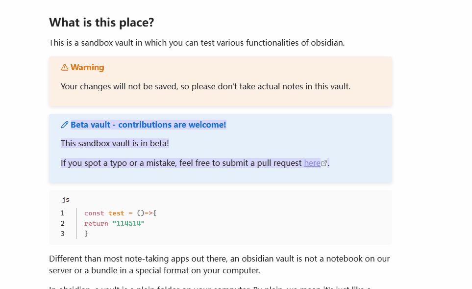

# Obsidian Text Finder

[English](README.md) | [中文说明](README-zh_CN.md)

A VS Code-like finder for the current note in [Obsidian](https://obsidian.md): find and replace Markdown source in **editing mode**, or search rendered text in **reading mode**.

## Features

- **Find and replace** — highlight matches, see the match count, jump between results, and replace one or all matches in editing mode.
- **Flexible matching** — regular expressions, case sensitivity and whole-word matching.
- **Search a selection** — search selected text in editing or reading mode; editing mode also supports multiple selections and replacements within them.
- **History and presets** — reuse previous queries and save named find/replace rules. Applying a preset never replaces note text automatically.
- **Independent split views** — each note view keeps its own finder and current match, even when showing the same file.
- **Customizable toolbar and appearance** — arrange or hide actions, adjust highlight colors and selection styling, move the finder, and optionally show a floating search entry.

## Demo

*Early-version demo; the current interface includes additional features.*

## Installation

Requires Obsidian **1.6.0 or later**.

### Method 1: Install from Obsidian's community plugins directory

In **Settings → Community plugins**, search for **Text Finder**, install it, and enable it.

### Method 2: Install using the Better Manager plugin

Install and enable [Better Manager](https://community.obsidian.md/plugins/better-plugins-manager), open its plugin manager, and use the GitHub installation option. Enter `https://github.com/nyable/obsidian-text-finder`, complete the installation, and enable **Text Finder**.

### Method 3: Install using the BRAT plugin

Install and enable [BRAT](https://community.obsidian.md/plugins/obsidian42-brat), run its **Add a beta plugin for testing** command, and enter `https://github.com/nyable/obsidian-text-finder`. Complete the installation and enable **Text Finder**.

### Method 4: Install manually

Download `main.js`, `styles.css` and `manifest.json` from the [latest release](https://github.com/nyable/obsidian-text-finder/releases/latest). Copy them into `<vault>/.obsidian/plugins/text-finder/` and enable the plugin. If your vault uses a custom configuration folder, use that instead of `.obsidian`.

## Quick start

1. Open a Markdown note and run **Text Finder: Open search in current file** from the command palette. You can also use **More options → Text Finder: Open find** in the note's top-right menu.
2. Enter a query. Use the previous/next buttons or Enter to navigate; toggle regex, match case or whole word as needed.
3. To replace text, switch to editing mode and run **Open search & replace in current file**. To limit the search, select note text and run **Open find in selection**, then enter your query.
4. Press Escape or click the close button to close the finder. Inputs and match options are retained by default.

Assign shortcuts in **Settings → Hotkeys**. Use **Show search history** to reuse queries, **Save current find as preset** to save a rule, and **Apply find / replace preset** to load one.

## Settings and appearance

- **General:** optionally show a floating search entry when opening notes, or collapse the finder when dragged to an edge. Both are off by default.
- **Find, Replace and Search history:** adjust search behavior, replacement escapes and history preferences.
- **Appearance:** preview colors and selection styling, reorder toolbar actions, choose Toolbar / More / Hidden, and set default match options.

Drag the left accent strip on desktop or the top-center grip on mobile to move the finder. Use **Restore finder position** if needed. For CSS customization, see the [style reference](docs/product/ui-baseline.md#样式来源与兼容接口) and [Style Settings example](style-settings.css).

## Notes and limitations

- Searches the **current note**, not the whole vault. Reading mode is find-only; it does not modify files or switch to editing mode.
- Editing searches Markdown source; reading searches rendered body text, so results may differ. Embedded notes, formulas, diagrams and some plugin-generated content are excluded.
- Unsupported reading environments fall back to Obsidian's native find. Selection-restricted search never silently falls back to a full-note search.

For detailed matching and replacement rules, see [features and limitations](docs/product/features.md). Source builds and maintenance information are in the [developer documentation](docs/README.md).
