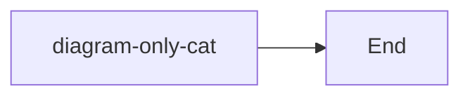

# 阅读模式查找验收

这份笔记用于在真实 Obsidian 中检查高亮与导航，不是自动测试的替代品。

## 行内格式与链接

hello **world**；hello _world_；hello `world`。

[使用指南](https://hidden-url.example/manual)

Cat cat CAT；中文关键词；😀 cat；İ cat。

## 列表与引用

- 第一项 cat
- 可折叠父项
    - 子项 cat
    - 子项 **hello** world

> 引用 cat
>
> hello **world**

> [!info]- 折叠 Callout
> Callout cat
> hello **world**

## 表格与代码

| 第一列          | 第二列 |
| --------------- | ------ |
| hello **world** | cat    |
| Cat             | CAT    |

```typescript
const cat = "hello world";
// cat
```

## 隐藏与排除范围

<!-- hidden-comment cat -->

<span hidden>hidden-text cat</span>

行内公式 $x + y$ 和图片不应被当作普通正文文字搜索。



## 硬换行

A<br><br>B

## 文件尾部

tail-only-cat

实际验收时，在“文件尾部”之前插入足够多的普通段落，确保它首次不在视口附近。
